# Web Engage - Deployment Architecture

## Cloud Deployment Diagram

```mermaid
graph TB
    %% Internet and CDN
    Internet[🌐 Internet]
    CDN[☁️ CDN<br/>CloudFlare/AWS CloudFront<br/>Global Edge Locations]
    
    %% DNS and Load Balancing
    DNS[🔍 DNS<br/>Route 53/CloudFlare DNS<br/>Health Checks]
    WAF[🛡️ Web Application Firewall<br/>AWS WAF/CloudFlare<br/>DDoS Protection]
    
    %% Production Environment
    subgraph "Production Environment - AWS/Azure/GCP"
        %% Availability Zones
        subgraph "Availability Zone A"
            ALB_A[⚖️ Application Load Balancer A<br/>AWS ALB/Azure Load Balancer<br/>SSL Termination]
            
            subgraph "Web Engage Cluster A"
                Gateway_A[🚪 API Gateway A<br/>Kong/AWS API Gateway<br/>Rate Limiting]
                
                subgraph "Core Services A"
                    ModuleLoader_A[📦 Module Loader A<br/>Node.js/React<br/>Container: 2 instances]
                    InteractiveChat_A[💬 Interactive Chat A<br/>WebSocket Server<br/>Container: 3 instances]
                    ContextServer_A[🔍 Context Server A<br/>Java/Node.js<br/>Container: 2 instances]
                    ConversationAPI_A[🗣️ Conversation API A<br/>REST/GraphQL<br/>Container: 3 instances]
                end
                
                subgraph "Analytics A"
                    TrackingAPI_A[📈 Tracking API A<br/>Event Collection<br/>Container: 2 instances]
                    TrackingHandler_A[🎯 Tracking Handler A<br/>Stream Processing<br/>Container: 2 instances]
                end
            end
        end
        
        subgraph "Availability Zone B"
            ALB_B[⚖️ Application Load Balancer B<br/>AWS ALB/Azure Load Balancer<br/>SSL Termination]
            
            subgraph "Web Engage Cluster B"
                Gateway_B[🚪 API Gateway B<br/>Kong/AWS API Gateway<br/>Rate Limiting]
                
                subgraph "Core Services B"
                    ModuleLoader_B[📦 Module Loader B<br/>Node.js/React<br/>Container: 2 instances]
                    InteractiveChat_B[💬 Interactive Chat B<br/>WebSocket Server<br/>Container: 3 instances]
                    ContextServer_B[🔍 Context Server B<br/>Java/Node.js<br/>Container: 2 instances]
                    ConversationAPI_B[🗣️ Conversation API B<br/>REST/GraphQL<br/>Container: 3 instances]
                end
                
                subgraph "Analytics B"
                    TrackingAPI_B[📈 Tracking API B<br/>Event Collection<br/>Container: 2 instances]
                    TrackingHandler_B[🎯 Tracking Handler B<br/>Stream Processing<br/>Container: 2 instances]
                end
            end
        end
        
        %% Shared Data Layer
        subgraph "Data Layer - Multi-AZ"
            %% Caching
            Redis_Primary[(💾 Redis Primary<br/>ElastiCache/Azure Cache<br/>Session Store)]
            Redis_Replica[(💾 Redis Replica<br/>Read Replicas<br/>Cross-AZ)]
            
            %% Message Queue
            MessageQueue[📬 Message Queue<br/>Amazon SQS/Azure Service Bus<br/>RabbitMQ Cluster]
            
            %% Analytics Database
            AnalyticsDB[(📊 Analytics Database<br/>ClickHouse/BigQuery<br/>Time-series Data)]
            
            %% Configuration Database
            ConfigDB[(⚙️ Configuration DB<br/>PostgreSQL/MySQL<br/>RDS Multi-AZ)]
        end
        
        %% Monitoring and Observability
        subgraph "Observability Stack"
            Prometheus[📊 Prometheus<br/>Metrics Collection<br/>Kubernetes/Docker]
            Grafana[📈 Grafana<br/>Monitoring Dashboards<br/>Alerting]
            ELK[📋 ELK Stack<br/>Elasticsearch/Logstash/Kibana<br/>Log Aggregation]
            Jaeger[🔍 Jaeger<br/>Distributed Tracing<br/>OpenTelemetry]
        end
    end
    
    %% External Integrations
    subgraph "External Systems"
        CXCore[🏛️ CX Core<br/>Microservices<br/>Separate Deployment]
        Analytics_External[📊 External Analytics<br/>Google Analytics<br/>Adobe Analytics]
        VirtualAgent[🤖 Virtual Agent<br/>AI/ML Platform<br/>Separate Deployment]
    end
    
    %% Traffic Flow
    Internet --> DNS
    DNS --> WAF
    WAF --> CDN
    CDN --> ALB_A
    CDN --> ALB_B
    
    %% Load Balancer Distribution
    ALB_A --> Gateway_A
    ALB_B --> Gateway_B
    
    %% Service Mesh
    Gateway_A --> ModuleLoader_A
    Gateway_A --> InteractiveChat_A
    Gateway_A --> ContextServer_A
    Gateway_A --> ConversationAPI_A
    Gateway_A --> TrackingAPI_A
    
    Gateway_B --> ModuleLoader_B
    Gateway_B --> InteractiveChat_B
    Gateway_B --> ContextServer_B
    Gateway_B --> ConversationAPI_B
    Gateway_B --> TrackingAPI_B
    
    %% Data Connections
    ContextServer_A <--> Redis_Primary
    ContextServer_B <--> Redis_Replica
    
    ConversationAPI_A --> MessageQueue
    ConversationAPI_B --> MessageQueue
    
    TrackingAPI_A --> TrackingHandler_A
    TrackingAPI_B --> TrackingHandler_B
    TrackingHandler_A --> AnalyticsDB
    TrackingHandler_B --> AnalyticsDB
    
    %% External Integrations
    ConversationAPI_A <--> CXCore
    ConversationAPI_B <--> CXCore
    TrackingHandler_A --> Analytics_External
    TrackingHandler_B --> Analytics_External
    ConversationAPI_A <--> VirtualAgent
    ConversationAPI_B <--> VirtualAgent
    
    %% Monitoring Connections
    ModuleLoader_A -.-> Prometheus
    InteractiveChat_A -.-> Prometheus
    ContextServer_A -.-> Prometheus
    ConversationAPI_A -.-> Prometheus
    TrackingAPI_A -.-> Prometheus
    
    ModuleLoader_B -.-> Prometheus
    InteractiveChat_B -.-> Prometheus
    ContextServer_B -.-> Prometheus
    ConversationAPI_B -.-> Prometheus
    TrackingAPI_B -.-> Prometheus
    
    Prometheus --> Grafana
    ELK --> Grafana
    
    %% Styling
    classDef external fill:#e1f5fe,stroke:#01579b,stroke-width:2px
    classDef service fill:#e8f5e8,stroke:#2e7d32,stroke-width:2px
    classDef database fill:#fff3e0,stroke:#ef6c00,stroke-width:2px
    classDef monitoring fill:#f3e5f5,stroke:#7b1fa2,stroke-width:2px
    classDef infrastructure fill:#ffebee,stroke:#c62828,stroke-width:2px
    
    class Internet,CDN,DNS,Analytics_External external
    class ModuleLoader_A,ModuleLoader_B,InteractiveChat_A,InteractiveChat_B,ContextServer_A,ContextServer_B,ConversationAPI_A,ConversationAPI_B,TrackingAPI_A,TrackingAPI_B,TrackingHandler_A,TrackingHandler_B service
    class Redis_Primary,Redis_Replica,AnalyticsDB,ConfigDB database
    class Prometheus,Grafana,ELK,Jaeger monitoring
    class WAF,ALB_A,ALB_B,Gateway_A,Gateway_B,MessageQueue infrastructure
```



## Deployment Specifications

### **Container Orchestration**
```yaml
# Kubernetes Deployment Example
apiVersion: apps/v1
kind: Deployment
metadata:
  name: interactive-chat
spec:
  replicas: 3
  selector:
    matchLabels:
      app: interactive-chat
  template:
    metadata:
      labels:
        app: interactive-chat
    spec:
      containers:
      - name: interactive-chat
        image: puzzel/interactive-chat:v1.2.3
        ports:
        - containerPort: 8080
        resources:
          requests:
            memory: "512Mi"
            cpu: "250m"
          limits:
            memory: "1Gi"
            cpu: "500m"
        env:
        - name: REDIS_URL
          valueFrom:
            secretKeyRef:
              name: redis-credentials
              key: url
        livenessProbe:
          httpGet:
            path: /health
            port: 8080
          initialDelaySeconds: 30
          periodSeconds: 10
        readinessProbe:
          httpGet:
            path: /ready
            port: 8080
          initialDelaySeconds: 5
          periodSeconds: 5
```

### **Auto-scaling Configuration**
```yaml
apiVersion: autoscaling/v2
kind: HorizontalPodAutoscaler
metadata:
  name: interactive-chat-hpa
spec:
  scaleTargetRef:
    apiVersion: apps/v1
    kind: Deployment
    name: interactive-chat
  minReplicas: 2
  maxReplicas: 10
  metrics:
  - type: Resource
    resource:
      name: cpu
      target:
        type: Utilization
        averageUtilization: 70
  - type: Resource
    resource:
      name: memory
      target:
        type: Utilization
        averageUtilization: 80
```

## Key Deployment Features

### 1. **High Availability**
- **Multi-AZ Deployment**: Services distributed across availability zones
- **Load Balancing**: Application load balancers with health checks
- **Database Replication**: Redis read replicas and RDS Multi-AZ
- **CDN**: Global content delivery network for static assets

### 2. **Scalability**
- **Horizontal Pod Autoscaling**: CPU and memory-based scaling
- **Container Orchestration**: Kubernetes for service management
- **Message Queues**: Decoupled async processing
- **Database Sharding**: Analytics data partitioned by time

### 3. **Security**
- **WAF**: Web Application Firewall for DDoS protection
- **SSL/TLS**: End-to-end encryption
- **Network Segmentation**: Private subnets for databases
- **Secret Management**: Kubernetes secrets for credentials

### 4. **Monitoring & Observability**
- **Metrics**: Prometheus for application metrics
- **Logging**: ELK stack for centralized logging
- **Tracing**: Jaeger for distributed tracing
- **Alerting**: Grafana for monitoring dashboards and alerts

### 5. **Disaster Recovery**
- **Cross-Region Backups**: Database backups in multiple regions
- **Blue-Green Deployment**: Zero-downtime deployments
- **Circuit Breakers**: Failure isolation and recovery
- **Health Checks**: Automated failure detection and recovery

This deployment architecture ensures the Web Engage system can handle high traffic loads, maintain high availability, and provide excellent performance for customer interactions.