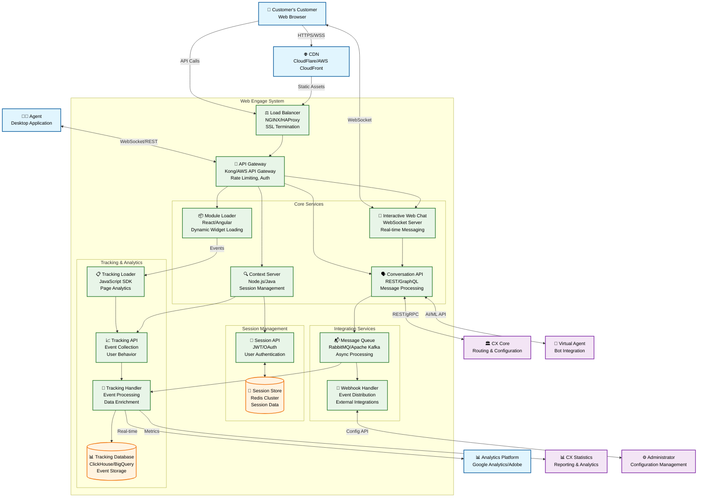

# Improved Web Engage Architecture

## Overview
Web Engage handles all interactions on the Customer's website towards Agents or Bots, with enhanced tracking, analytics, and user experience capabilities.

## Architecture Diagram

## Key Improvements Made

### 1. **Simplified Visual Structure**
- Grouped related components into logical subsystems
- Reduced arrow complexity with cleaner flow paths
- Added clear system boundaries and swimlanes

### 2. **Enhanced Technical Details**
- **Technology Stack**: Added specific technologies for each component
- **Protocols**: Specified communication protocols (HTTPS, WebSocket, REST, gRPC)
- **Infrastructure**: Included load balancer, API gateway, and CDN

### 3. **Added Missing Components**
- **Load Balancer**: For high availability and SSL termination
- **API Gateway**: For rate limiting, authentication, and API management
- **CDN**: For static asset delivery and performance
- **Message Queue**: For asynchronous processing
- **Session Store**: Redis cluster for session management

### 4. **Improved Data Flow**
- **Numbered Flow**: Clear sequence of operations
- **Async vs Sync**: Distinguished between real-time and batch processing
- **Error Handling**: Implicit through queue-based architecture

### 5. **Security & Performance**
- **SSL/TLS**: HTTPS and WSS for secure communication
- **Authentication**: JWT/OAuth integration
- **Caching**: CDN and session store for performance
- **Rate Limiting**: API gateway protection

### 6. **Operational Concerns**
- **Monitoring**: Integration with analytics platforms
- **Scalability**: Load balancer and distributed architecture
- **Resilience**: Queue-based async processing

## Component Responsibilities

### **Core Services**
- **Module Loader**: Dynamically loads chat widgets and forms
- **Interactive Web Chat**: Handles real-time customer conversations
- **Context Server**: Manages user context and session state
- **Conversation API**: Processes and routes messages

### **Tracking & Analytics**
- **Tracking API**: Collects user behavior events
- **Tracking Loader**: Client-side analytics SDK
- **Tracking Handler**: Processes and enriches event data
- **Tracking Database**: Stores analytics data for reporting

### **Integration Services**
- **Webhook Handler**: Manages external system notifications
- **Message Queue**: Handles asynchronous processing
- **Session API**: Manages user authentication and sessions

This improved architecture provides better separation of concerns, clearer data flows, and addresses scalability, security, and operational requirements that were missing from the original diagram.