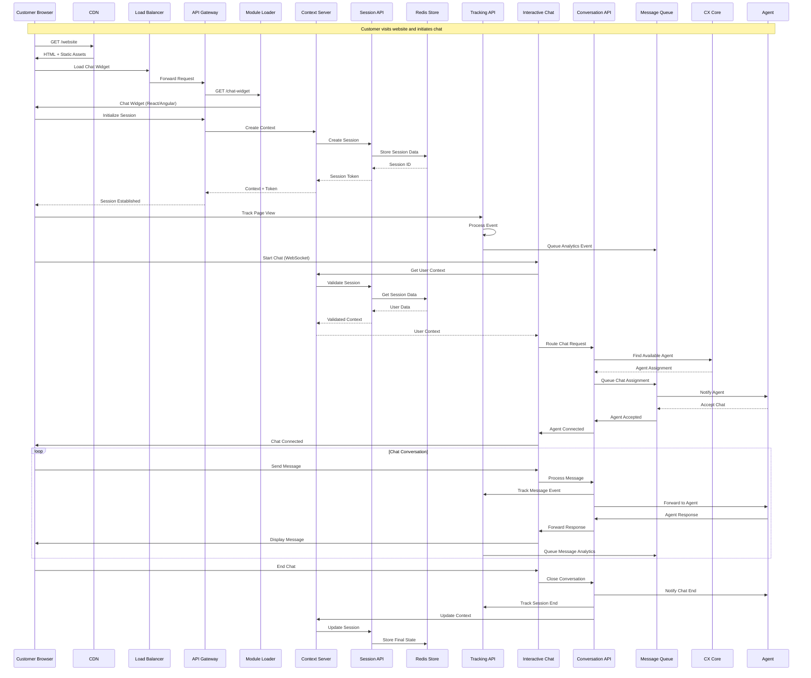
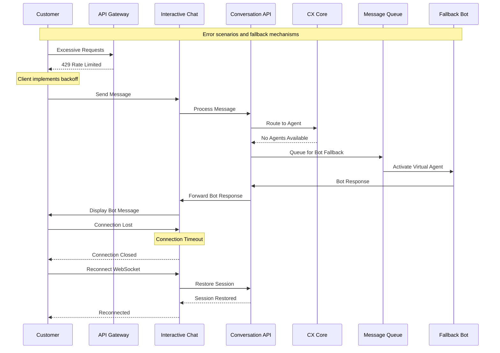

# Web Engage - User Interaction Sequence

## Typical Customer Chat Initiation Flow

## Error Handling Flow

## Key Sequence Improvements

### 1. **Clear Flow Separation**
- **Initialization**: Session setup and authentication
- **Real-time Communication**: WebSocket-based messaging
- **Analytics**: Asynchronous event tracking
- **Error Handling**: Fallback mechanisms

### 2. **Performance Optimizations**
- **CDN Usage**: Static asset delivery
- **Session Caching**: Redis for fast session retrieval
- **Async Processing**: Queue-based analytics and notifications

### 3. **Resilience Patterns**
- **Rate Limiting**: API gateway protection
- **Fallback Mechanisms**: Bot activation when agents unavailable
- **Reconnection Logic**: WebSocket recovery
- **Circuit Breakers**: Implicit through queue-based architecture

### 4. **Security Measures**
- **Token-based Authentication**: JWT/OAuth integration
- **Session Validation**: Every request validated
- **SSL/TLS**: All communications encrypted